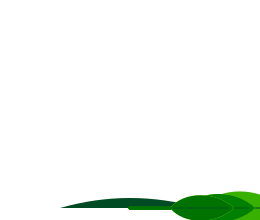
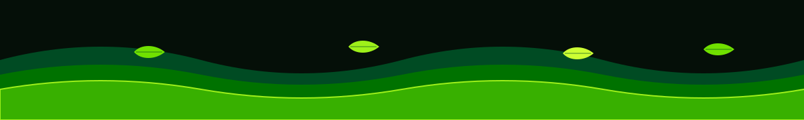

<a href="https://git.io/typing-svg">
<picture>
  <source media="(prefers-color-scheme: dark)" srcset="https://readme-typing-svg.demolab.com?font=Fira+Code&weight=600&size=22&pause=1200&color=9ef01a&center=true&vCenter=true&width=700&lines=Electrical+Engineering+Student+%E2%9A%A1;Full+Stack+Developer+%F0%9F%92%BB;Cloud+Enthusiast+%E2%98%81%EF%B8%8F;GDG+Member+%F0%9F%8C%BF;Hackathon+Winner+%F0%9F%8F%86;Chasing+Google+DeepMind+%F0%9F%9A%80" />
  <source media="(prefers-color-scheme: light)" srcset="https://readme-typing-svg.demolab.com?font=Fira+Code&weight=600&size=22&pause=1200&color=007200&center=true&vCenter=true&width=700&lines=Electrical+Engineering+Student+%E2%9A%A1;Full+Stack+Developer+%F0%9F%92%BB;Cloud+Enthusiast+%E2%98%81%EF%B8%8F;GDG+Member+%F0%9F%8C%BF;Hackathon+Winner+%F0%9F%8F%86;Chasing+Google+DeepMind+%F0%9F%9A%80" />
  
</picture>
</a>

 

  

  
<i>Rooted in core engineering. Growing in code.</i>

## 🌿 &nbsp;About Me

> *Energetic and curious. I love both core engineering concepts and cutting-edge web tech. I build interactive experiences and enjoy solving complex problems.*

<table>
<tr>
<td width="50%" valign="top">

**🎓 Education**
- B.Tech, Electrical Engineering
- Haldia Institute of Technology *(2025 – Present)*
- Science Stream (PCMB), Tamluk Hamilton High School

**📍 Based in**
- Tamluk, West Bengal, India

**🏆 Highlights**
- 9.5 SGPA in 1st Year
- 1× Hackathon Winner
- Member of Google Developer Groups (GDG)

</td>
<td width="50%" valign="top">

**🎯 Goals**
- 🥇 **Primary: Google DeepMind**
- 9+ CGPA
- Internships at ISRO / DRDO / Microsoft

**🧠 Learning Style**
- Night owl 🦉
- Structured notes, flowcharts & tables

**🎮 Off-duty**
- Chess ♟️ · Call of Duty 🎮 · Personal Branding

</td>
</tr>
</table>

## 🌱 &nbsp;Currently Growing

<table>
<tr>
<td width="200" align="center"></td>
<td valign="top">

⚡ **Core Engineering Studies** *(targeting GATE)* &nbsp; 

🧩 **DSA & Problem Solving** &nbsp; 

☁️ **Cloud Skills & Full Stack Projects** &nbsp; 

⚛️ **Advanced React & Animations** &nbsp; 

🗣️ **Communication Skills** &nbsp; 

♟️ **Chess & Call of Duty** *(strategy for the mind)* &nbsp; 

</td>
</tr>
</table>

## 🛠️ &nbsp;Tech Stack

<table>
<tr><td><b>Languages & Core</b></td><td>
 
DSA • Problem Solving • Core Electrical Concepts
</td></tr>
<tr><td><b>Frontend & Design</b></td><td>
 

</td></tr>
<tr><td><b>Backend, DB & Mobile</b></td><td>

</td></tr>
<tr><td><b>Cloud</b></td><td>

</td></tr>
<tr><td><b>Embedded & Hardware</b></td><td>

</td></tr>
<tr><td><b>Tools & Deployment</b></td><td>
 

</td></tr>
</table>

## 🌳 &nbsp;Featured Projects

<table>
<tr>
<td width="50%" valign="top">

**🔌 Smart Lab Asset Tracker**
IoT asset tracking for labs: ESP32 + RFID hardware with a MERN dashboard.
`ESP32` · `RFID` · `MongoDB` · `Express` · `React` · `Node.js`
[Repo]([ADD_REPO_URL])

</td>
<td width="50%" valign="top">

**📰 HITian Inside**
Redesign of the official media club website of Haldia Institute of Technology.
[Live](https://hitianinside.in) · [Repo]([ADD_REPO_URL])

</td>
</tr>
<tr>
<td width="50%" valign="top">

**📚 Bilbili**
Educational blog with an admin panel and nested topics/subtopics.
`Next.js` · `Firebase Auth` · `Firestore`
[Live]([ADD_LIVE_URL]) · [Repo]([ADD_REPO_URL])

</td>
<td width="50%" valign="top">

**🎮 Three.js Story Shooter** *(in progress)*
Story-based browser shooter where the protagonist completes missions.
`Three.js` · `JavaScript`
[Repo]([ADD_REPO_URL])

</td>
</tr>
</table>

<b>🍃 More projects</b>

 

- **HITian Inside Management App**: Flutter app with backend work. [Repo]([ADD_REPO_URL])
- **EEvolution**: website for an electrical engineering org (projects, academic repo, blogs, events). [Link]([ADD_URL])
- **Ritvi Fabrics**: website for an Instagram-based ethnic wear and fabric brand. [Link]([ADD_URL])

## 📊 &nbsp;GitHub Stats

## 🐍 &nbsp;Contribution Snake

<picture>
  <source media="(prefers-color-scheme: dark)" srcset="https://raw.githubusercontent.com/sayanjc3639q/sayanjc3639q/output/github-snake-dark.svg" />
  <source media="(prefers-color-scheme: light)" srcset="https://raw.githubusercontent.com/sayanjc3639q/sayanjc3639q/output/github-snake.svg" />
  
</picture>

## 🏆 &nbsp;Achievements

<table>
<tr>
<td align="center" width="25%">🎓 <b>9.5 SGPA</b> 1st Year</td>
<td align="center" width="25%">🏆 <b>Hackathon</b> 1× Champion</td>
<td align="center" width="25%">🥇 <b>Primary Goal</b> Google DeepMind</td>
<td align="center" width="25%">🌿 <b>GDG</b> Google Developer Groups</td>
</tr>
</table>

### ⚡ *"Balancing ambition with discipline, one line of code at a time."*

🌟 *Thanks for visiting. Star my repos if you find them helpful!* 🌟

